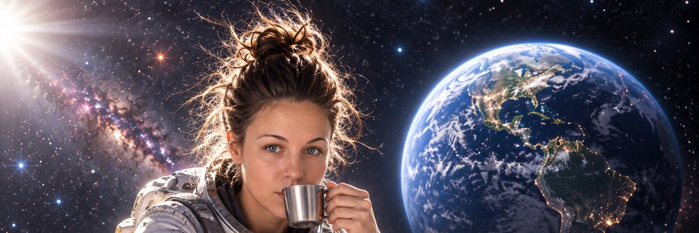

  <b>AI creator · SMM & promotion · AI agents</b> 
  Создаю нейровидео и изображения, развиваю SMM-продвижение, делаю AI-агентов

  

---

## What I do / Чем занимаюсь

- 🎬 **AI creator** — AI video, images, ads and series made with neural networks / нейровидео, изображения, реклама, сериалы
- 📈 **SMM & YouTube promotion** — strategy, content plans, channel growth / стратегии, контент-планы, рост каналов
- 🤖 **AI agents** — self-hosted tools that save hours of routine work / агенты, которые забирают рутину

## Featured project / Главный проект

**[Open News Monitor](https://github.com/ozerova152-lab/open-news-monitor)** — self-hosted news monitoring agent: RSS and websites in, deduplicated source-linked digests out (Telegram, email, Google Sheets).
Агент мониторинга новостей: сам следит за источниками, убирает повторы и присылает только новое.

## Links / Ссылки

